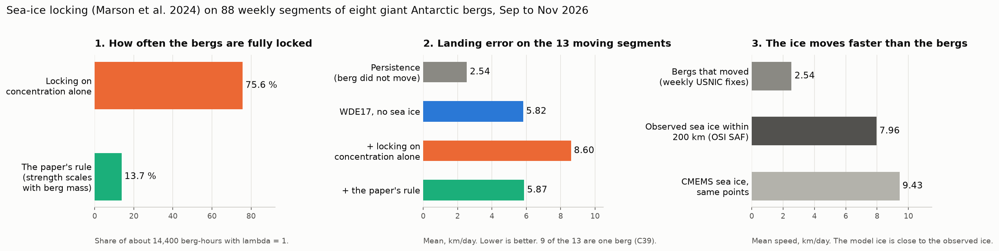

# Sea-ice locking on the iceberg hindcast

Run on 2026-11-24, at the paper's default parameters. Nothing was tuned.

**Result in three lines**

- With the paper's rule as written, our giant bergs are fully locked for only
  13.7 % of their time. The hindcast error is about the same as with no sea
  ice at all: median 4.34 against 4.31 km/day.
- A simpler version that locks on concentration alone locks them 75.6 % of
  the time and makes the moving bergs worse: mean 8.60 against 5.82 km/day.
- Persistence ("the berg did not move") still beats every variant.



## A correction, stated first

This experiment was scored twice, and the order matters.

1. **First run (v3, v4).** The brief for this work gave the strength
   threshold `P_s` as the sea-ice drag formula (the paper's Eq. 2) divided by
   berg width. That was a transcription error.
2. **Reading the paper's PDF** showed that `P_s` is something else: the force
   per unit width needed "for sea ice to resist (without breaking) all the
   other forces imposed on the iceberg", that is, the paper's Eq. 3 divided
   by berg width.
3. **Second run (v5, v6).** The paper's `P_s` was implemented and scored the
   same day. No parameter was changed. v5 and v6 were run after the v3/v4
   result was known. That is a weakness of this test and is why both runs
   are shown.

The first run is kept, not replaced. The script checks on every run that
v1 to v4 still come out exactly as first scored.

## The rule

Marson, J. M., Myers, P. G., Garbo, A., Copland, L., & Mueller, D. (2024).
Sea ice-driven iceberg drift in Baffin Bay. *JGR Oceans*, 129, e2023JC020697.
https://doi.org/10.1029/2023JC020697

The paper adds sea-ice locking (SIL) to the NEMO iceberg module. In dense,
strong pack ice a berg stops moving through the ice and moves with it.

At each step, at the berg position:

- `V_sumF` is the berg velocity from all other forces.
- `V_si`, `A` and `h` are the sea-ice velocity, concentration and thickness.
- Ice strength: `P = P* · h · exp(−20 (1 − A))`, with `P* = 20,000 N/m²` (Eq. 4).
- Strength needed: `P_s = |F_c + F_p + F_r + F_a + F_o| / W` (Eq. 3 over the
  berg width `W`). These are the Coriolis, pressure-gradient, wave, air-drag
  and water-drag forces. `P_t = 0.8 · P_s`.
- Concentration thresholds: `A_s = 0.90`, `A_t = A_s − 0.04 = 0.86`.
- A ramp `α` goes from 0 at the lower threshold to 1 at the upper one (Eq. 5).
  It is applied to `A` and to `P`.
- `λ = α_A · α_P` (Eq. 6).
- Berg velocity: `V = (1 − λ) · V_sumF + λ · V_si` (Eq. 7).
- At `A ≤ 0.15` sea ice has no effect.

Because `P_s` contains the Coriolis force, it grows with berg mass. A giant
berg needs much stronger ice to hold it than a small one. For a 30 × 20 km
berg, 250 m thick, with the ice moving 0.1 m/s relative to the current,
`P_s` is about 85,000 N/m. One metre of full pack ice has `P = 20,000 N/m`.

The code is `models/iceberg/sil.py`. The integrator hook is the `ice_field`
argument of `forecast_track` in `dakshin/berg_forecast.py`.

## Where our version differs from the paper

1. **Berg dynamics.** We use the closed form of Wagner, Dell and Eisenman
   (2017), not NEMO-ICB.
2. **No wind, no waves.** So `F_a` and `F_r` are zero in `P_s`.
3. **Surface currents only.** No average over the keel depth.
4. **Daily sea ice.** We use day 0 of each archived CMEMS cycle, interpolated
   in time. The paper uses the model's own time step.
5. **The ramp sign.** Eq. 5 is printed, in the journal PDF too, with
   `(v_t − v_s)` under the fraction, which is negative. We use `(v_s − v_t)`.
6. **Where `P_s` is evaluated.** NEMO-ICB steps the berg's momentum. A closed
   form has no momentum to step, so we ask what the ice must supply to hold
   the berg at the ice velocity. Berg thickness is assumed to be 250 m,
   because USNIC publishes none.
7. **The unlocked case.** In the paper an unlocked berg can still feel
   sea-ice drag when `A > 0.15`. Our drift model has no such term, so an
   unlocked berg is plain WDE17. One consequence: the 15 % floor never
   changes anything in our version.

Four sea-ice dates are stale in the archive (`KNOWN_STALE.md`). Each was
filled from the previous good day: 09-20 from 09-19, 10-11 from 10-10, 11-10
from 11-09, 11-17 from 11-16.

## Data

- 88 segments between consecutive weekly USNIC fixes, 4 Sep to 20 Nov 2026,
  eight bergs, inside 0–80°E and 55–78°S.
- 13 segments moved more than 3 km ("moving"). 75 did not ("still").
- Nine of the 13 moving segments are one berg, C39.
- Sea-ice data was present at every berg-hour. No step fell back for lack of ice.

## Results

Landing error in km/day, shown as median (mean). A held berg predicts no
further motion and is scored from where it was held.

| Variant | Held | All 88 | Moving 13 | Still 75 |
|---|---|---|---|---|
| Persistence (berg did not move) | – | 0.00 (0.39) | 2.45 (2.54) | 0.00 (0.02) |
| v1: WDE17 only | 7 | 4.31 (4.98) | 6.01 (5.82) | 4.23 (4.84) |
| v2: + grounding | 26 | 4.13 (4.52) | 6.01 (5.62) | 3.95 (4.33) |
| v3: + locking on concentration alone (first run) | 7 | 4.38 (5.40) | 6.40 (8.60) | 4.29 (4.85) |
| v4: + grounding + the same | 25 | 4.25 (4.83) | 6.40 (7.83) | 3.52 (4.31) |
| **v5: + SIL, the paper's `P_s`** | 8 | 4.34 (4.82) | 6.01 (5.87) | 4.29 (4.64) |
| **v6: + grounding + SIL, the paper's `P_s`** | 21 | 4.06 (4.38) | 6.01 (5.67) | 3.84 (4.16) |

v1 and v2 reproduce `berg_hindcast.json` row for row. The 4.35 km/day quoted
there is v1 over the 81 segments that were not stopped at the coast. The 4.31
here is the same run over all 88.

Segment by segment against v1:

| | Better | Worse | Equal |
|---|---|---|---|
| v3 (concentration alone) | 38 | 44 | 6 |
| v5 (the paper's `P_s`) | 26 | 14 | 48 |
| v5, moving segments only | 0 | 3 | 10 |

### How often the bergs lock

| | v3: concentration alone | v5: the paper's `P_s` |
|---|---|---|
| Berg-hours integrated | 14,440 | 14,472 |
| Hours with any locking (`λ > 0`) | 85.3 % | 19.9 % |
| Hours fully locked (`λ = 1`) | 75.6 % | 13.7 % |
| Segments with any locking | 82 of 88 | 55 of 88 |
| Hours with no sea-ice data | 0 % | 0 % |

In v3 the strength threshold is the drag form. It is a few N/m at real ice
speeds, so the ice always passes it and locking depends on concentration
alone. That treats a 30 km berg like a 100 m one.

### Sea ice at the bergs

Model sea ice at the observed berg positions, sampled at noon each day:

| | Still bergs | Moving bergs |
|---|---|---|
| Mean ice concentration | 0.92 | 0.87 |
| Share of days at `A ≥ 0.90` | 78 % | 62 % |
| Mean ice speed | 6.7 km/day | 12.3 km/day |

### Is the model's ice velocity right?

Checked against observed ice drift: EUMETSAT OSI SAF low-resolution sea-ice
drift, OSI-405-d (doi:10.15770/EUM_SAF_OSI_NRT_2007). These are
satellite-tracked 48-hour displacements on a 62.5 km grid.
`scripts/ice_drift_check.py`, 31 Aug to 21 Nov 2026, same box.

| | Vectors | Observed | CMEMS | CMEMS / observed | Correlation (east, north) |
|---|---|---|---|---|---|
| Whole box | 53,800 | 12.05 km/day | 10.61 km/day | 0.88 | 0.86, 0.81 |
| Where `A ≥ 0.90` | 33,818 | 11.62 | 10.49 | 0.90 | 0.84, 0.80 |
| Within 200 km of a hindcast berg | 4,933 | 7.96 | 9.43 | 1.18 | 0.66, 0.66 |

Speeds are means. The observation uncertainty is about 3.6 km/day per
component (one standard deviation, from the product itself).

The model ice is not too fast overall. It is 12 % slow across the box and
18 % fast near the bergs. Real pack ice within 200 km of these bergs moves
about 8 km/day. The bergs moved a median of 2.45 km/day when they moved at
all. So the gap in v3 is between the bergs and the ice, not between the
model ice and the real ice.

One limit: the product has no vectors close to the coast or the ice edge.
Ice right beside a grounded berg, or fast ice, may be slower than this.

### Sensitivity (not used to pick anything)

Median (mean) km/day over all 88 segments.

v3, concentration alone. `P*` made no difference at any `A_s`:

| `A_s` | All 88 | Moving 13 | Hours fully locked |
|---|---|---|---|
| 0.85 | 4.82 (5.56) | 6.64 (8.89) | 86.7 % |
| 0.90 | 4.38 (5.40) | 6.40 (8.60) | 75.6 % |
| 0.95 | 4.38 (5.28) | 5.92 (7.84) | 55.9 % |

v5, the paper's `P_s`. Here `A_s` made almost no difference and `P*` decides.
Shown at `A_s = 0.90`:

| `P*` | All 88 | Moving 13 | Still 75 | Hours fully locked |
|---|---|---|---|---|
| 10,000 | 4.31 (4.97) | 6.01 (5.83) | 4.23 (4.83) | 2.1 % |
| **20,000 (paper)** | 4.34 (4.82) | 6.01 (5.87) | 4.29 (4.64) | 13.7 % |
| 40,000 | 4.26 (4.56) | 6.01 (5.98) | 4.15 (4.31) | 32.7 % |

## What it means

**The paper's strength test is what protects giant bergs from over-locking.**
Because `P_s` scales with berg mass, ice at `P* = 20,000` can hold these
bergs only when the ice and the current nearly agree. The rule then locks
them 13.7 % of the time and changes little. Take the size dependence away
(v3) and the same bergs lock 75.6 % of the time and are carried off with ice
they were not moving with.

**With the paper's rule the error barely changes.** Median 4.34 against 4.31
km/day, mean 4.82 against 4.98. v5 is better than v1 on 26 segments and
worse on 14. On the 13 moving segments it is never better: 10 equal, 3
worse. We cannot call this an improvement.

**Still bergs are a grounding problem.** They did not move while the ice
around them drifts 6.7 km/day in the model. Grounding (v2) helps: 26
segments held, still median 3.95. Grounding plus the paper's rule (v6) has
the lowest error of all variants, 4.06 (4.38), but the step from v2 is small.

**Persistence beats everything.** On the moving segments v1 beat persistence
2 times in 13, v5 twice, v3 once.

## What this does not show

- **It is not a test of the paper's result.** The paper's bergs are in Baffin
  Bay and were checked against beacon tracks. Ours are giant Antarctic
  tabular bergs at USNIC's tracking size (about 10 nautical miles on the long
  axis, or 20 square nautical miles), and 75 of our 88 segments show no motion.
- **v5 and v6 were run after v3 and v4 were seen.** The reason was a
  transcription error, not the result, and no parameter was changed. It is
  still a second look at the same data.
- **`P_s` depends on things we assumed.** Berg thickness (250 m), no wind,
  no waves, forces evaluated at the ice velocity. A different thickness
  moves `P_s` in proportion.
- **We cannot separate the rule from its inputs.** A bad landing point can
  come from the locking rule, from the currents, from the missing wind, or
  from a berg dragging its keel. The model ice velocity is the one input we
  checked.
- **Thirteen moving segments, nine from one berg.** That is too few to
  generalise from.
- **Weekly fixes, accurate to a few km.** There are no beacons. We only see
  where a berg was a week later, not the path it took. A berg that was locked
  for two days and free for five looks the same as one that drifted slowly
  all week.

## How to reproduce

```
python scripts/berg_sil_hindcast.py      # writes dakshin/figures/berg_sil_hindcast.json
python scripts/ice_drift_check.py        # writes dakshin/figures/ice_drift_check.json
python scripts/plot_sil_experiment.py    # writes dakshin/figures/sil_experiment.png
python -m pytest models/iceberg/test_sil.py dakshin/test_berg_forecast.py dakshin/test_ice_field.py -q
```

The hindcast script stops if v1 or v2 no longer reproduce `berg_hindcast.json`,
or if v1 to v4 differ from the first scoring run.
